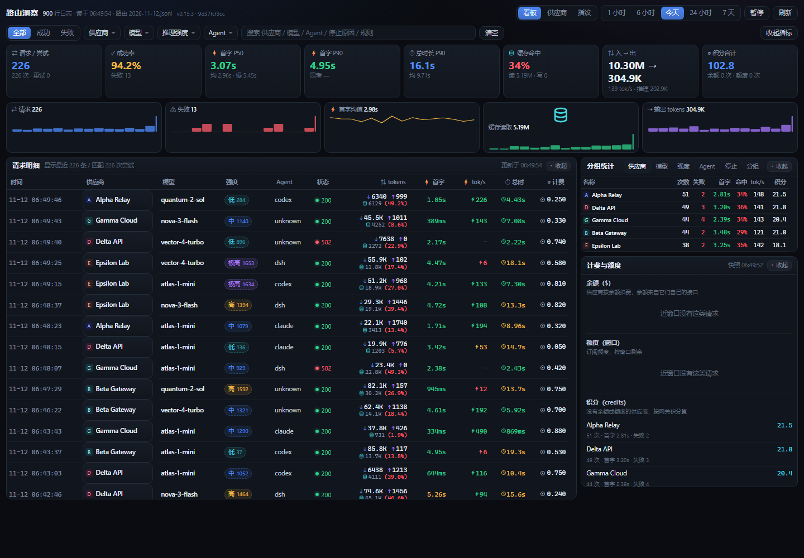
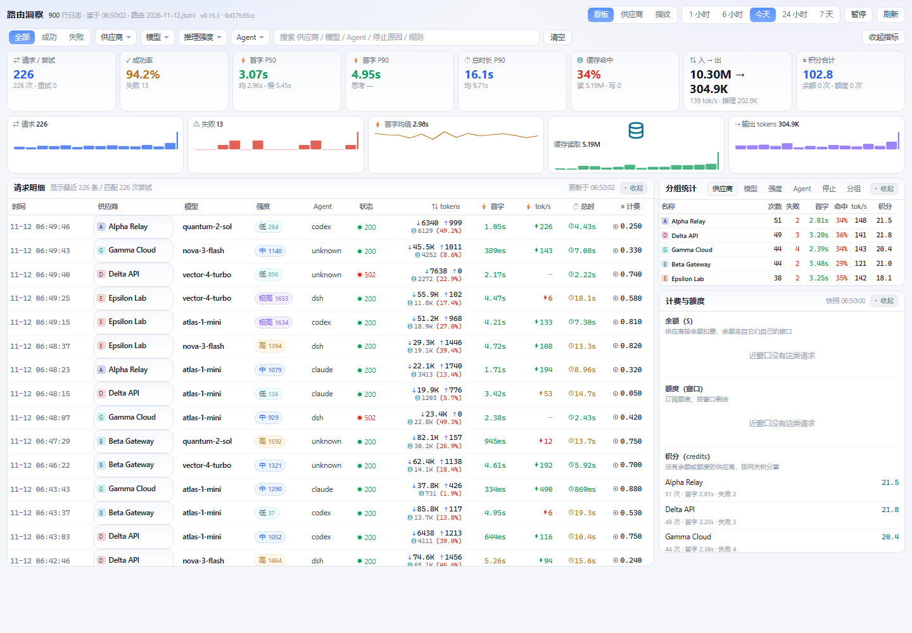
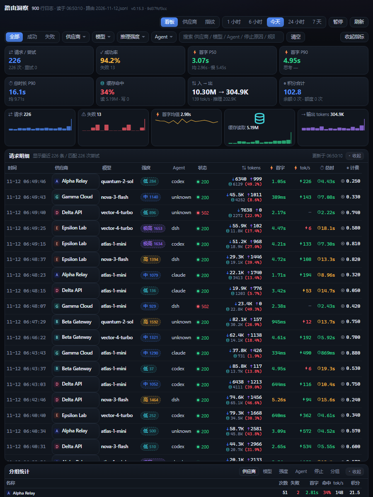
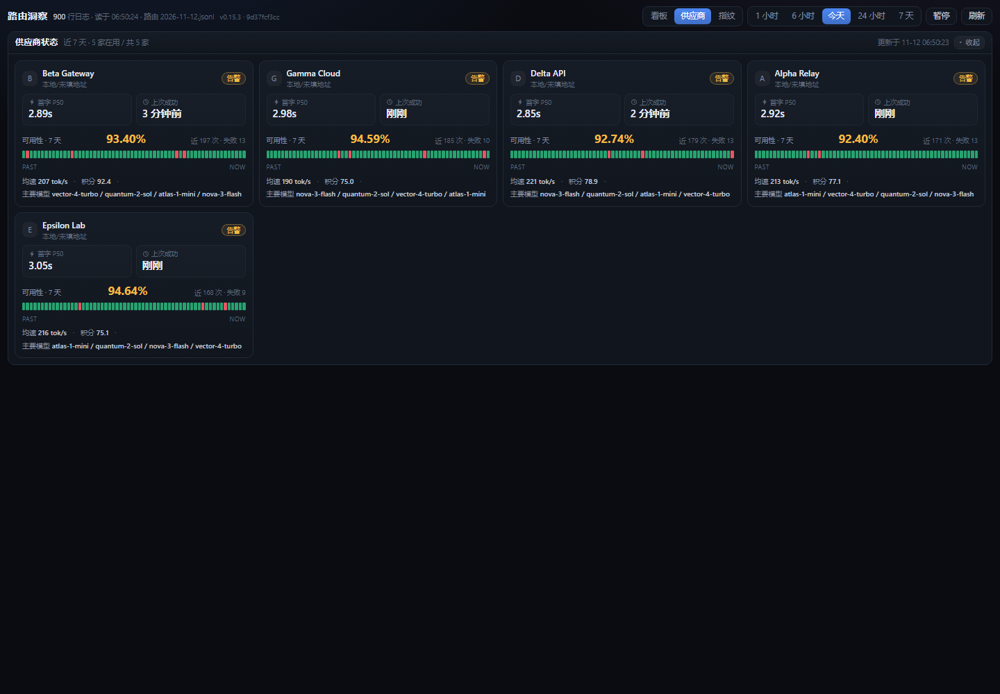

# 路由洞察 Route insight

magpie 侧边栏的一个页面：把网关自己写的 `usage.jsonl` 读成一块实时看板 —— 每次请求的首字、总时长、缓存命中、token、速度和计费方式，按供应商 / 模型 / 推理强度 / Agent / 时间窗筛选，并把分组统计、趋势、失败码、正在休息的席位、余额与额度放在同一屏。

> 只读。插件不接管路由、不改 magpie 配置、不发任何出站请求，全部数据来自本机 `~/.config/magpie`。

> **English** — A page for magpie's sidebar that turns the gateway's own `usage.jsonl` into a live routing board: first-byte time, total duration, cache hit rate, tokens, output speed and how each call was billed — filterable by provider / model / reasoning effort / agent / time window, with group stats, trends, error codes, resting accounts, balance and quota on the same screen. Read-only: it never routes, never edits magpie's config, never makes an outbound request. Also includes a provider status view (per-route cards with uptime and recent-call strips) and a model-fingerprint + "draw a pelican" intelligence check with candidate ranking.



## 布局

顶栏三个视图，同一份数据换三种看法：

- **看板**（默认）：8 格 KPI + 5 条趋势 + 请求明细 + 分组统计 + 计费与额度
- **供应商**：每家线路一张卡（头像、状态、首字 P50、上次成功、7 天可用性、近 60 次彩条、均速 / 积分 / 主要模型）
- **指纹**：选模型跑指纹家族 + 一键画鹈鹕，出图卡 + 检测历史

看板是两栏：左请求明细（11 列，窄屏自动收起 Agent 列），右分组统计（6 个 tab）+ 计费与额度。整页按内容高度自然撑开、需要时整页滚动；每张卡内部的表格另有一层最大高度（请求 58vh、分组 36vh），所以收起一张卡是真的只剩一条标题栏，而不是留一块空白。

宽度断点：≥1300px 两栏 KPI 8 格；<1300px KPI 折成 4 格；<1180px 收成单栏；<760px KPI 与趋势都折成 2 列。供应商卡是 auto-fill minmax(310px, 1fr)，1440px 下四列。

请求明细里原本四列（入 / 缓存读 / 命中率 / 出）合并成一格两行：上行 `↓ 入 ↑ 出`，下行 `[圆柱图标] 缓存读 (命中率)`，速度单独一列 `⚡ tok/s`。全表用符号打头便于扫读：⇄ 请求、✓ 成功率、⚡ 首字、⏱ 总时、⇅ tokens、◎ 计费。

`⚡ tok/s` 与 `⏱ 总时` 按快慢上色（速度 ≥60 绿 / 25–60 黄 / <25 红；总耗时 ≤8s 绿 / 8–22s 黄 / >22s 红），首字和命中率同理，扫一眼就知道哪几行慢。图标都是内联 SVG（`Segoe UI` 里没有合适的单字符，▤ / ⛁ / ⇢ 在 Windows 上会渲染成空框或对不齐）。




## 改完就自动刷新

顶栏最右边有个构建号（`v0.7.0 · <短哈希>`）。服务端对 ui/ 下所有文件的 mtime+size 算一个短哈希，页面每 5 秒问一次；只要我改过界面，页面自己刷新一次，不会出现「明明改了却还是旧样子」的错觉。

## 折叠与收指标

每张卡的**整条标题栏都能点**（右侧还有一个写明「收起 / 展开」的小按钮），KPI + 趋势那一整块用顶栏的「收起指标」整体收起，状态记在 localStorage 的 route-insight-fold 里，刷新后保持。

上一版「收起」看着没生效：卡片高度被 CSS 网格行钉住，内容藏起来了、卡片还占着原高度。现在布局改成内容驱动（`.board` 用 `align-items:start`、右栏改 flex 竖排、表格各自带 max-height），收起后实测请求卡 614px → 33px、分组卡 396px → 35px，就剩一条标题栏。

## 强度列是真的还是猜的

优先显示网关自己记下来的 effort（high / medium / low…，显示成 高 / 中 / 低，实线边框）。

deepseek 这类链路 magpie 不写 effort，只留下**思考 token 数**（usage 里的 reasoning）。所以列里改成「**相对强度 + 数字**」：低 / 中 / 高 / 极高，后缀是这次请求的思考 token 数（例如 `高 1153`），用**虚线边框**跟真实档位区分。分档用当前这批行自己的 P50 / P75 / P90，比写死阈值更贴近「这次算多想」；鼠标悬停会给出这三个分位值，并说明是相对值、不是官方档位。

没有思考 token 的显示 `无思考`。派生的东西绝不当成官方 effort 值。

派生档位也进了筛选和分组：上方「推理强度」下拉里会多出 `思考·低 / 思考·中 / 思考·高 / 思考·极高` 四项，右侧分组统计切到「强度」标签就能按档位看次数、失败、首字、命中、速度、积分——所以 deepseek 这种不写 effort 的链路，也能回答「想得多的那些请求是不是更慢更贵」。

## 供应商状态

顶栏「供应商」页：每家线路一张卡，模仿渠道监控站的排法——头像（就是 magpie 自己那份供应商图标，走 `/icons/<hash>.svg`）、名字、状态点，下面 5 个数字格（请求 / 成功率 / 首字 P50 / 均速 / 积分），再一条 60 格的彩条（一格一次最近的请求，绿成功 / 黄慢 / 红失败，PAST → NOW），最后一行小字写「可用性 99.6% · 上次成功 3 分钟前 · 主要模型 xxx」。

状态判定：已停用 / 没流量 / 错误（成功率 <85%）/ 告警（<98% 或 6 小时没成功）/ 正常。这个视图每 8 秒自己刷新一次，看板不动。



## 指纹与智商检测

顶栏「指纹」页：选一个模型，两项检测同时跑，也可以勾掉其中一项只测单个。会花真实积分，按钮旁边先写「预计 N 次请求」，跑完在结果卡右上角给出实际用量（几次请求、成功几次、扣多少积分 / 走余额还是额度）。

结果是一张卡，跟渠道站的「检测图」一个排法：

- **上半出图**：白底区域直接渲染模型画的鹈鹕 SVG（洗干净：去掉 script / foreignObject / on* 事件 / 外部 href），下面四行小字——模型 / 时间 / 强度（= 指纹判定出的家族）/ 耗时。
- **下半指纹信息**：家族结论一句话（一致 / 矛盾且确信 / 自述不足 → 以路由为准，矛盾时提示「要么中转换了模型，要么路由标签不实」）+ **候选排名**（整个候选库按分数排，名字、概率条、百分比，命中路由的那行打「路由」标，底下小字写「有效样本 n/2 · 家族 X · 概率只在候选之间归一化，是打分不是统计置信度」）+ 各项信号明细。
- 权重规则：路由权重 1，自述权重按可信度打折（自评「不确定」只算 0.25）。
- **概率条是真的按比例**：条的轨道极淡，填充长度 = 概率本身（最小留 0.7% 宽，否则 0.0% 那几行彻底看不见）。条长由 JS 用 CSSOM 写 `transform: scaleX()`，**不是** HTML 里的 `style="width:…"`——页面 CSP 是 `style-src 'self'`（不含 `unsafe-inline`），行内 style 属性会被浏览器整条丢弃，宽度就退回 100%，看着每行都满格。以后再加条状图请照着这个写法。
- **检测历史**：每次跑完记一条（模型 / 时间 / 家族 / 耗时 / 请求数 / 积分），重开窗口还在。最近 6 次的**完整结果**（含 SVG）也留在本地，点历史里那一条就能把当时那张卡重新打开；更早的只留摘要。

### 模型选择器

原来的 `<select>` 塞不下头像、也没法搜，所以自己画了一个：

- 触发器：**供应商头像**（就是 magpie 自己那份图标，走 `/icons/<hash>.svg`）+ 模型名 + 家族 / 供应商。
- 面板：顶部一个搜索框（匹配模型名、供应商、家族），下面按供应商分组，每组标题也带头像和条数；每行是 `模型名 → 家族 → 调用次数`，选中的那行打 ✓。
- 键盘：`↑` / `↓` 移动，`↵` 选中，`Esc` 关闭；点面板外面也关。
- 同一个模型挂在多家线路下时，分组就是区分它们的唯一线索——这也是不再用平铺下拉的原因。

### 出图与放大

鹈鹕 SVG 直接内联渲染（洗过：去 script / foreignObject / on* 事件 / 外部 href）。画布默认按 `min(100%, 360px)` 居中显示，**点一下放大**到 680px（上限 80vh），再点还原；右下角有「点一下放大 / 点一下还原」的提示。之前 `max-height: 38vh` 的写法在矮窗口里会把图压成一小块，看着像没渲染出来。

单个检测说明：**指纹家族**是一次自述采集（模型名 / 厂商 / 知识截止 / 上下文窗口 / 是否思考 / 默认语言 / 与 GPT-4 的关系 / 自评可信度）+ 一次系统提示泄漏探针；**一键画鹈鹕**让它画「骑自行车的鹈鹕」SVG，量结构密度、颜色数、有无 text 标签、viewBox、耗时——思考型模型常把长度预算烧在思考上导致空答，这里给 8000 token 预算并在空答时换一句更硬的指令重试一次。


## 它比「用量 → 请求」多给了什么

| 字段 | 自带请求列表 | 这个页面 |
| --- | --- | --- |
| 首字 ttft | 有 | 有，并且给 P50 / P90 / 最慢 / 均值，并按快慢染色 |
| 总时长 | 有 | 有，并且给 P90 与均值 |
| 缓存读 cache_read | 有 | 有，并算出**命中率 = 缓存读 ÷（输入 + 缓存读）**，按命中比例染色 |
| 缓存写 cache_write | — | 有 |
| 输出速度 tok/s | 有 | 有，按分组汇总 |
| 推理 token | — | 有 |
| 推理强度 effort / 命中规则 | — | 从 `routing/<日期>.jsonl` 按 `responseId` 对齐回来 |
| 上行 / 脱敏 / 下行分段耗时 | — | 汇总成均值（sent / masking / flow） |
| 改道（同一请求多次尝试） | 换行 | 计数 + 改道率 |
| 失败码分布 | 逐条 | 汇总分布 |
| 计费方式 | 只有积分 | 分三类：**积分**（无余额无额度）、**余额**（供应商报 $ 余额）、**额度**（codex 的 5 小时 / 7 天窗口） |
| 正在休息的席位、余额、额度 | 在别的页 | 同屏 |
| 时间窗 | 今天 | 1 小时 / 6 小时 / 今天 / 24 小时 / 7 天 |
| 组合筛选 | — | 供应商 × 模型 × 推理强度 × Agent × 状态 × 关键字，每项都可多选 |

## 安装

从 GitHub 装（推荐，别人也能用同一条命令）：

```bash
magpie plugin add "github:InvisibleGuardian007/magpie-route-insight"
```

这个仓库打了 `magpie-plugin` 标签，所以也会出现在 magpie 的「发现 → 非官方插件 · GitHub」里，卡片上标「包自己的话」（未经审阅），点一下就从仓库装上。

从本地目录装（开发时用）：

```bash
magpie plugin add "D:/数据/AI/magpie-plugins/route-insight"
```

或者在 `~/.config/magpie/plugins.json` 里加一项：

```json
{ "spec": "D:/数据/AI/magpie-plugins/route-insight", "options": { "window": "today" } }
```

保存后插件宿主会自动重载。侧边栏「插件」分组里出现「路由洞察 Route insight」，在 magpie 窗口内直接打开；也可以单独用浏览器打开 <http://127.0.0.1:4397>。

跳板页和官方 page 插件同一种做法：拿到 `magpie.ready` / `options` 后**直接**导航到 `http://127.0.0.1:<port>/?theme=&lang=&uiOrigin=`，不做探活（探活会被页面 CSP 的 `connect-src 'none'` 拦掉，反而跳不过去）。8 秒后页面还在，或者手动加 `?diag=1`，才显示排查面板（目标地址、`magpie.service`、options、页面来源、浏览器）。

## 地址栏参数

页面跟着 magpie 的主题走（bridge 会传 `theme` / `lang`）。直接开浏览器时也可以手写：
`http://127.0.0.1:4397/?theme=dark&window=1h`，`window` 取 `1h` `6h` `today` `24h` `7d`。

## 选项

| 选项 | 默认 | 说明 |
| --- | --- | --- |
| `port` | 4397 | 本地服务端口；页面通过 bridge 读这里的值再跳转 |
| `window` | `today` | 打开时的时间窗：`1h` `6h` `today` `24h` `7d` |
| `historyBytes` | 25165824 | 首次从 `usage.jsonl` 尾部读多少字节（24 MB ≈ 8 天）；之后只读新增 |
| `keepRows` | 60000 | 内存里最多保留多少条尝试记录 |

对应的环境变量：`MAGPIE_ROUTE_INSIGHT_PORT`、`MAGPIE_ROUTE_INSIGHT_WINDOW`、`MAGPIE_ROUTE_INSIGHT_HISTORYBYTES`、`MAGPIE_ROUTE_INSIGHT_KEEP_ROWS`。

## 数据怎么来的

- 一行 `usage.jsonl` = 一次**尝试**；同一个 `route_id` 的多行 = 一次请求被改道重试。所以「请求数」按 `route_id` 去重，「尝试数」是行数。
- 首字用 `ttft_ms`；失败的尝试通常没有首字，不计入分位数。
- 命中率用 `cache_read / (in + cache_read)`：`in` 是未命中缓存的那部分输入。
- 推理强度、命中的规则、原始请求模型、路由分组来自 `routing/<本地日期>.jsonl`，按 `response_id` 对齐；对不上的行留空，不猜。走 deepseek 这类不带 effort 的模型时，强度列显示 `—` 是正常的。
- 计费三分类：`quotas.json` 里同一供应商有 `windows` 就是**额度**（codex 账号），有 `balance` 就是**余额**（中转站），两者都没有按**积分**看。同一供应商多把 key 的余额相加。
- 只读四个文件：`usage.jsonl`、`routing/<日期>.jsonl`、`quotas.json`、`rests.json`（谁在休息），外加 `providers.json` 取供应商中文名。没有第三方请求，没有遥测。

## 隐私

页面服务只绑 `127.0.0.1`，校验 Host 头，CSP 只允许自己的脚本、样式和同源 fetch；不显示 `client_ip`、会话 id、请求内容或密钥。

## 开发

```bash
node test.mjs                 # 27 条断言：字段收敛、去重、命中率、分位数、多选筛选、effort 分桶、计费分类、路由对齐
node index.mjs                # 直接起服务，浏览器打开 127.0.0.1:4397
node index.mjs --port 4398    # 端口冲突时
```

## 截图

| 看板（深色） | 看板（浅色） |
| --- | --- |
|  |  |

| 供应商状态 | 指纹与智商检测 |
| --- | --- |
|  |  |

窄窗口（900×1200，单栏）：

## 版本

每次改动都会前进一版，逐版条目见 [CHANGELOG.md](CHANGELOG.md)。当前 0.8.0。

## License

MIT